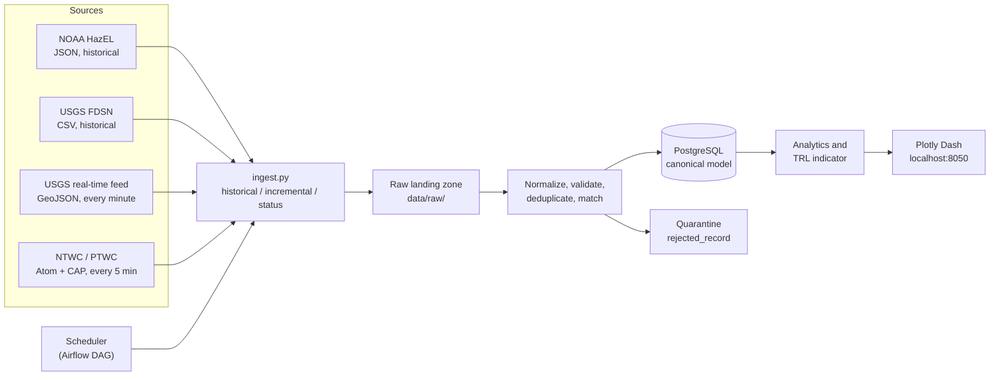

# Workshop 1 architecture diagram

High-level architecture of the tsunami monitoring system, adapted from the course reference architecture. All components run locally with Docker Compose. The scheduler runs `ingest.py --mode incremental`; the Plotly Dash dashboard reads only from the database. The report figure `workshop_1/report/figures/architecture.png` is exported from this diagram with [mermaid.live](https://mermaid.live) (Config: `{"theme": "default", "look": "classic"}`).

The geographic scope, ingestion contract and indicator shown here are described in the Workshop 1 report (Sections 1.3, 6 and 7.4).
