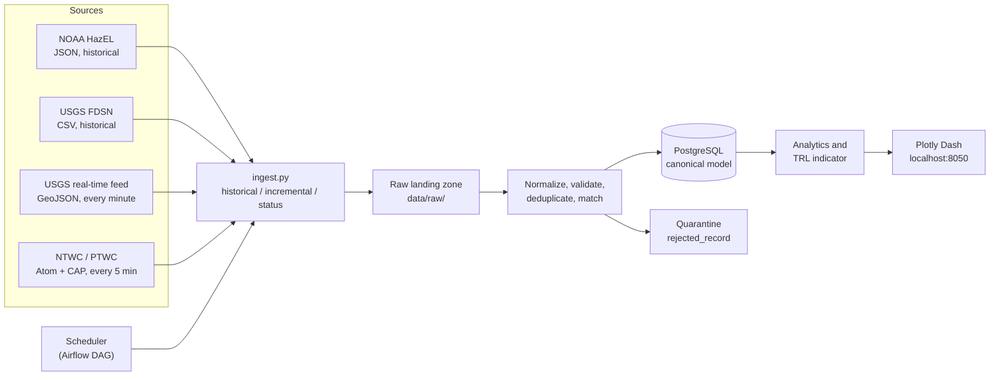

# Workshop 1 architecture diagram

Proposed high-level architecture of the tsunami monitoring system, adapted from the course reference architecture. The planned components run locally with Docker Compose: a scheduler would run `ingest.py --mode incremental`, and a Plotly Dash dashboard would read from PostgreSQL. Workshop 1 implements a raw-download stub; the scheduler, database loading, watermark tracking, and dashboard remain to be integrated. The current `ingest.py --mode status` lists raw files, not database row counts or watermarks. The report figure `workshop_1/report/figures/architecture.png` is exported from this diagram with [mermaid.live](https://mermaid.live) (Config: `{"theme": "default", "look": "classic"}`).

The geographic scope, proposed ingestion contract, and indicator are described in the Workshop 1 report (Sections 1.2.3, 3.2, and 3.3, respectively).
