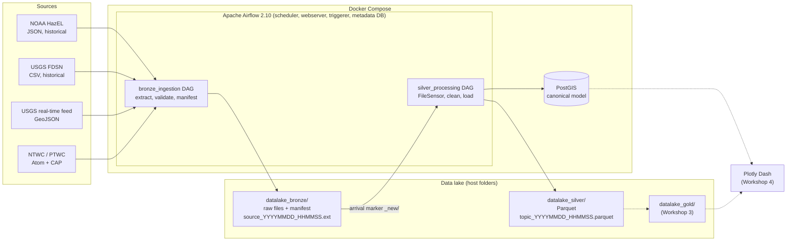

# Workshop 2 medallion architecture diagram

Bronze/Silver pipeline as implemented in Workshop 2, with the Gold layer and the dashboard planned for later workshops. Everything runs locally with Docker Compose (`compose.yaml`). The report figure `workshop_2/report/figures/architecture_medallion.png` is exported from this diagram with [mermaid.live](https://mermaid.live) (Config: `{"theme": "default", "look": "classic"}`).

