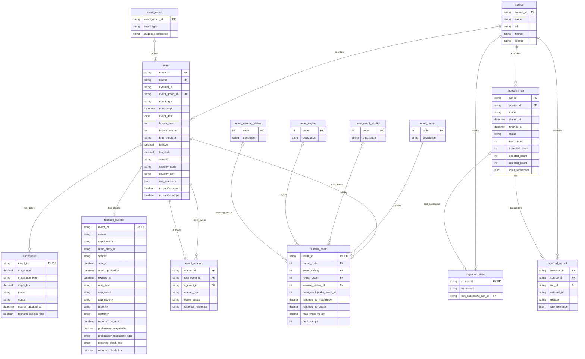

# Workshop 1 entity–relationship diagram

Each `event` represents an observation from a single source, identified by its original `external_id` and an internal `event_id`. Updated records retain their identifier, while original files are preserved for traceability.

`event_group` groups verified observations of the same real-world event, while `event_relation` connects related earthquakes, tsunamis, and official bulletins. These relationships allow the system to preserve information from each source without incorrectly merging different phenomena.

Each `event` has one corresponding detail record in `earthquake`, `tsunami_event`, or `tsunami_bulletin`, depending on its `event_type`. An `event_group` contains at least two verified observations of the same event, while `event_relation` stores possible matches and relationships between events, together with their review status.

Optional relationships allow the model to handle missing information without creating artificial values. The proposed structure supports the current Workshop 1 requirements and can be extended during database implementation.

Field definitions and normalization rules are documented in [workshop_1/mapping.md](../workshop_1/mapping.md).