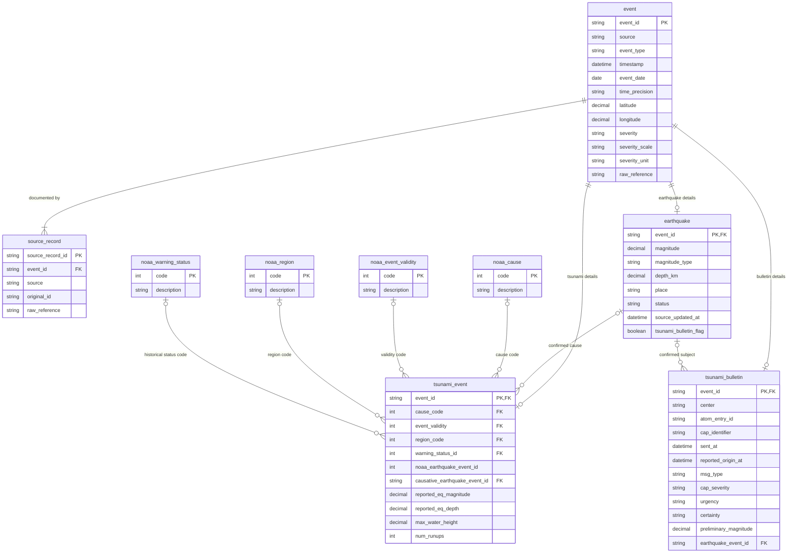

# Preliminary entity–relationship diagram

This Workshop 1 diagram shows proposed identities and optional links. Each `event` has one matching domain row (`earthquake`, `tsunami_event`, or `tsunami_bulletin`) according to `event_type`. The three optional lines from `event` express that subtype choice; they do not mean that a single event should have all three rows. A source record identifies a saved observation, while `event_id` identifies the internally represented event.

`o|` on the earthquake side means a tsunami or bulletin can have no linked earthquake. A link is set only after review, not from matching source IDs alone. The four descriptor relationships are nullable; a missing NOAA code stays null. CAP `cap_severity` belongs to the bulletin and is unrelated to `noaa_warning_status`. Full column definitions and normalization rules are in `workshop_1/mapping.md`.
